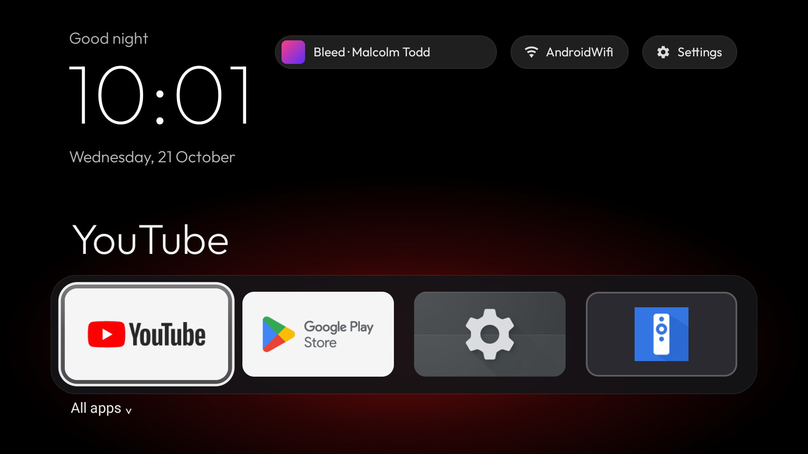
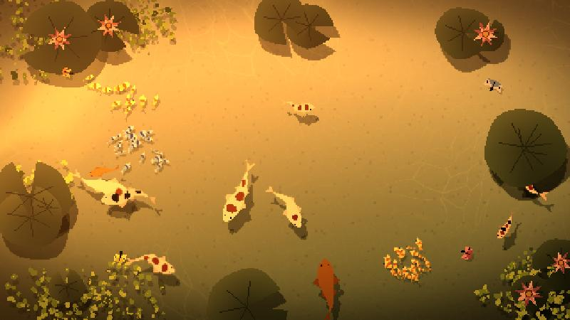
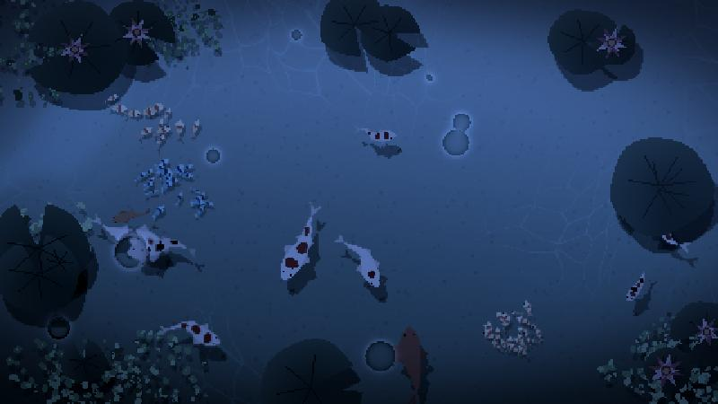
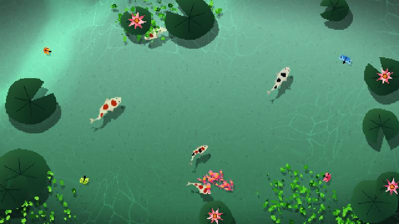
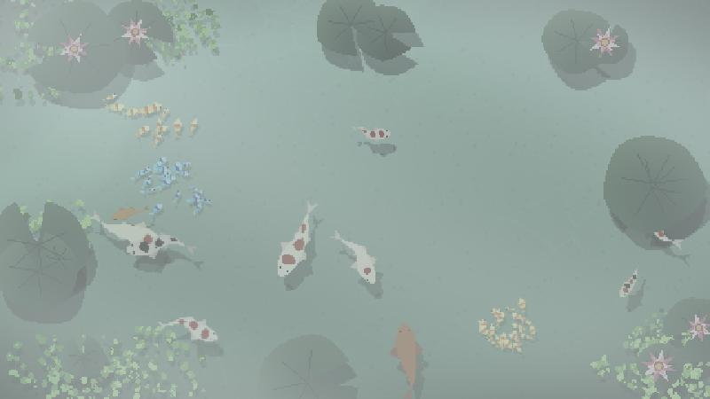
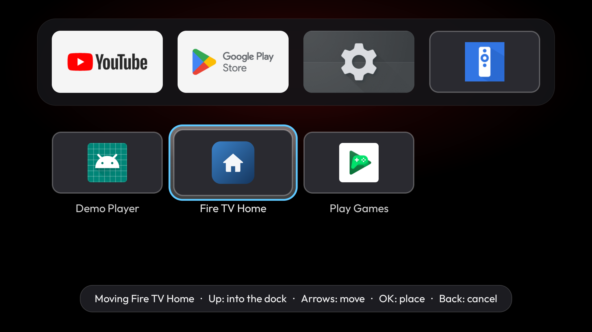
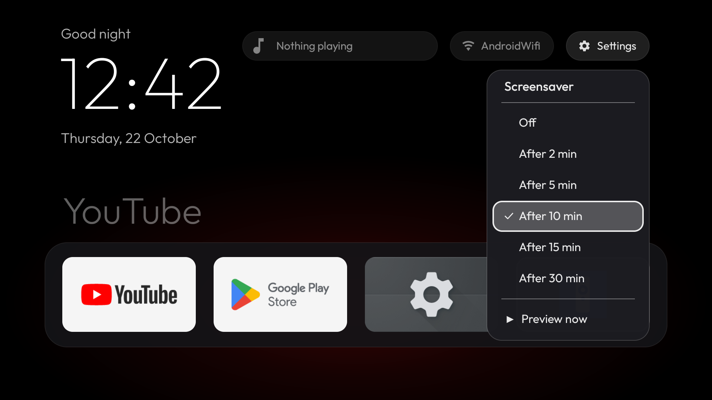

# Glass TV

**A calmer Fire TV Stick: no ads, no tracking, a clean home screen and a koi pond screensaver.**

Glass TV turns a stock Fire TV Stick into something that feels like a nice piece of furniture instead of a billboard.
It builds on [Fire TV Glass](https://github.com/ivantrj/firetv-glass-launcher) by ivantrj and adds a Now Playing pill,
tiles you can rearrange, a Settings menu that behaves, and a hand-drawn koi pond that shows up when the TV is idle.
The pond follows the real time of day and the weather outside.



<table>
  <tr>
    <td></td>
    <td></td>
  </tr>
  <tr>
    <td></td>
    <td></td>
  </tr>
</table>

No root. Nothing is uninstalled: Amazon's packages are only disabled, and one script turns everything back on.

## Built on the work of others

This project would not exist without two open-source projects. Please go star them:

| | Project | Author | What it provides here | Licence |
|---|---|---|---|---|
| 📺 | **[Fire TV Glass](https://github.com/ivantrj/firetv-glass-launcher)** | [ivantrj](https://github.com/ivantrj) | The Glass launcher itself, the debloat list and the install/restore scripts. Everything in [`glass-launcher/`](glass-launcher) is a fork of it. | MIT |
| 🎏 | **[nagomi](https://github.com/msk1039/nagomi)** | [Mayank Kadam (msk1039)](https://github.com/msk1039) | The koi pond: the fish, water, lily pads and weather. [`screensaver/nagomi/`](screensaver/nagomi) is a copy of it with a TV screensaver mode added. | PolyForm Noncommercial 1.0.0 |

Glass TV adds the Now Playing pill, tile moving, the Settings menu, Home handling and the screensaver integration on
top. See [Credits and licences](#credits-and-licences) for details.

## Features

- **Home screen that stays yours.** The Home button always opens Glass, including from inside Fire TV Settings and
  from apps like Netflix. A **Fire TV Home** tile opens Amazon's home when you actually want it.
- **Now Playing pill.** Shows the album art and "Title · Artist" of whatever is playing (Spotify, YouTube, …).
  Select pauses and resumes, Menu (☰) opens the app. Dimmed with a pause badge while paused.
- **Rearrange your tiles.** Press Menu (☰) on any tile, pick *Move*, and use the arrows. Up from the grid puts an app
  in the four-slot dock; OK places it, Back cancels.

  

- **Koi pond screensaver.** Starts after 2 to 30 idle minutes (your choice, or off) and never while something is
  playing. Every start is a new pond: different fish, lily pads and flowers, and one time in twenty a giant gold or
  platinum koi. The sky matches your local sunrise, sunset and weather (sunny, overcast, mist, rain, sunset,
  moonlight). Any key closes it. There is also a **Koi Pond** tile to start it whenever you like.

  

- **A Settings menu that works.** Jumps straight into Fire TV Settings (stock Fire OS bounces you through Amazon's
  home first) and holds the screensaver options.
- **Debloat.** Switches off Amazon's telemetry, ad and recommendation services and preloaded apps, all reversible.

## What you need

- A Fire TV Stick (built and tested on a **Fire TV Stick 4K Max, 2nd gen, Fire OS 8.1**; others may work)
- A computer on the same Wi-Fi with **JDK 17+**, the **Android SDK** (Android Studio installs it) and `adb`
- For the debloat scripts from upstream: Python 3 (macOS/Linux shell scripts)

## Let your agent do it

Have a coding agent with a terminal (Claude Code, Codex, Cursor and similar)? Do the three TV steps under
[1. On the TV](#1-on-the-tv) yourself. Then paste the prompt below into the agent, and keep the remote nearby: the
TV will ask you to allow debugging.

```text
Install Glass TV (https://github.com/R4maa/glass-tv-launcher) on my Fire TV Stick. Follow the repo's README; it is the
source of truth. Work step by step and tell me what you're doing as you go.

1. Ask me for my Fire TV Stick's IP address (Settings > My Fire TV > About > Network). I have already turned on ADB
   debugging. Don't continue until I've given you the IP.
2. Check my computer for git, JDK 17 or newer, the Android SDK and adb (adb is in the SDK's platform-tools). If
   something is missing, tell me what it is and how to install it for my OS, and ask before you install anything.
3. Clone the repo. In glass-launcher/launcher, write local.properties with sdk.dir set to my Android SDK, then build
   with the Gradle wrapper (gradlew.bat assembleDebug on Windows, ./gradlew assembleDebug elsewhere). If the build
   fails, read the error and fix the environment, not the project's code.
4. Run "adb connect <IP>:5555". Tell me to look at the TV, tick "Always allow" and accept the "Allow USB debugging?"
   prompt. Wait for me, then check that "adb devices" lists the stick as "device", not "unauthorized".
5. Install app/build/outputs/apk/debug/app-debug.apk with "adb -s <IP>:5555 install -r -g". Then run the three
   commands from README step 3 that turn on the Glass Home button accessibility service and the Now Playing
   notification access.
6. Ask me to press Home on the remote and confirm that Glass opens.
7. Ask whether I want Glass's koi pond as the screensaver. If yes, tell me to set Fire TV Settings > Display & Sounds
   > Screensaver > Start Time to Never. Once I have, run the two README step 4 commands that restore the 15-minute
   sleep timeout.
8. Do NOT run any debloat script or disable any packages unless I explicitly ask. If I ask, show me
   glass-launcher/debloat/disable-list.txt first and let me remove anything I use.
9. When you're done, summarise what changed and how to undo it (README "Undoing everything"). Remind me to turn off
   ADB debugging in Developer Options.

Never factory-reset, uninstall Amazon apps, or change settings other than the ones listed here.
```

## Setup

### 1. On the TV

1. **Settings › My Fire TV › About**: click the device name 7 times to unlock Developer Options.
2. **Settings › My Fire TV › Developer Options**: turn on **ADB debugging**.
3. **Settings › My Fire TV › About › Network**: note the IP address.

### 2. Build Glass

Windows (PowerShell):

```powershell
git clone https://github.com/R4maa/glass-tv-launcher.git
cd glass-tv-launcher\glass-launcher\launcher
"sdk.dir=$($env:LOCALAPPDATA -replace '\\','/')/Android/Sdk" | Set-Content local.properties -Encoding ascii
.\gradlew.bat assembleDebug
```

macOS / Linux:

```bash
git clone https://github.com/R4maa/glass-tv-launcher.git
cd glass-tv-launcher/glass-launcher/launcher
echo "sdk.dir=$HOME/Library/Android/sdk" > local.properties   # or wherever your SDK lives
./gradlew assembleDebug
```

The APK lands in `app/build/outputs/apk/debug/app-debug.apk`. The koi pond is already built into the app's assets, so
you don't need Node unless you change the pond.

### 3. Install it on the stick

Replace `192.168.1.50` with your stick's IP. The first connection makes the TV ask **Allow USB debugging?**: tick
"Always allow" and accept.

```bash
adb connect 192.168.1.50:5555
adb -s 192.168.1.50:5555 install -r -g app/build/outputs/apk/debug/app-debug.apk
```

Then give Glass the two permissions it needs, once:

```bash
adb -s 192.168.1.50:5555 shell settings put secure enabled_accessibility_services com.ivantrj.glasslauncher/com.ivantrj.glasslauncher.HomeButtonService
adb -s 192.168.1.50:5555 shell settings put secure accessibility_enabled 1
adb -s 192.168.1.50:5555 shell cmd notification allow_listener com.ivantrj.glasslauncher/com.ivantrj.glasslauncher.MediaListener
```

- **Glass Home button** (accessibility service) is how Glass takes over the Home button. Fire OS does not let you pick
  another launcher, so this is the standard workaround.
- **Notification access** lets the Now Playing pill read other apps' media sessions.

Press Home on the remote: you should land in Glass.

### 4. Let Glass be the screensaver (optional)

In **Fire TV Settings › Display & Sounds › Screensaver**, set **Start Time** to **Never**, then choose the idle time in
Glass's own **Settings › Screensaver** menu. Picking *Never* also tells Fire OS never to sleep; to keep the normal
15-minute sleep, run:

```bash
adb -s 192.168.1.50:5555 shell settings put system screen_off_timeout 900000
adb -s 192.168.1.50:5555 shell settings put secure contextual_screen_off_timeout 900000
```

### 5. Debloat (optional)

[`glass-launcher/debloat.sh`](glass-launcher/debloat.sh) disables the packages listed, with notes, in
[`glass-launcher/debloat/disable-list.txt`](glass-launcher/debloat/disable-list.txt). Read the list and remove anything
you use before running it. See the [upstream README](glass-launcher/README.md) for the full walkthrough.

## Undoing everything

- **From the TV:** the **Fire TV Home** tile opens Amazon's home. To stop Glass taking Home entirely, go to
  **Fire TV Settings › Accessibility › Glass Home button › Off**.
- **From Windows:** [`firestick-restore.ps1`](firestick-restore.ps1) re-enables the disabled packages, turns Amazon's
  screensaver back on and gives Home back to Amazon.

  ```powershell
  .\firestick-restore.ps1 -Stick 192.168.1.50          # everything
  .\firestick-restore.ps1 -Stick 192.168.1.50 -Glass   # just give Home back
  ```

- **From macOS/Linux:** [`glass-launcher/restore.sh`](glass-launcher/restore.sh).

Remember to switch **ADB debugging** off again when you're done.

## Repository layout

| Path | What it is |
|---|---|
| [`glass-launcher/`](glass-launcher) | The launcher: Android project (Java, Gradle) plus upstream's debloat/install scripts |
| [`screensaver/nagomi/`](screensaver/nagomi) | The koi pond, a vendored copy of [nagomi](https://github.com/msk1039/nagomi) with a `?tv=1` screensaver mode ([changes](screensaver/nagomi/GLASS-CHANGES.md)) |
| [`screensaver/build.ps1`](screensaver/build.ps1) | Rebuilds the pond into the launcher's assets (needs Node; only after editing the pond) |
| [`demo-player/`](demo-player) | A tiny fake music player for testing Now Playing in an emulator, where Spotify won't run |
| [`firestick-restore.ps1`](firestick-restore.ps1) | Undo script for Windows |

## Good to know

- The pond looks up your rough location from your IP ([ipwho.is](https://ipwho.is)) and the weather from
  [Open-Meteo](https://open-meteo.com). Offline, it falls back to the clock.
- On a Fire TV Stick 4K Max the pond runs at about 20–23 fps (target 30).
- Amazon's sponsored row and hero banner come from Amazon's servers and can't be removed by debloating; with Glass as
  your home screen you just don't see them.
- Some Amazon packages are "protected" and can't be disabled, and a Fire OS update may switch disabled ones back on.
- This is a debug build. Installing from a different computer later means uninstalling the old one first.

## Credits and licences

- **[Fire TV Glass](https://github.com/ivantrj/firetv-glass-launcher)** by [ivantrj](https://github.com/ivantrj),
  MIT, Copyright (c) 2026 ivantrj ([licence](glass-launcher/LICENSE)). Forked at upstream commit `95523e5`; the
  launcher, its design, the debloat list and the scripts are theirs, and this repo's changes build on them.
- **[nagomi](https://github.com/msk1039/nagomi)** by [Mayank Kadam (msk1039)](https://github.com/msk1039),
  **PolyForm Noncommercial 1.0.0** ([licence](screensaver/nagomi/LICENSE)). Vendored at commit `01e93a4`; the
  changes made for the TV are listed in [GLASS-CHANGES.md](screensaver/nagomi/GLASS-CHANGES.md). The pond, and any
  build that includes it, may only be used for non-commercial purposes.

  Required Notice: Copyright 2026 Mayank Kadam (https://github.com/msk1039)
- **Outfit** font, SIL Open Font License ([licence](glass-launcher/launcher/app/src/main/assets/fonts/OFL.txt)).

Not affiliated with Amazon. Fire TV is a trademark of Amazon.com, Inc.
